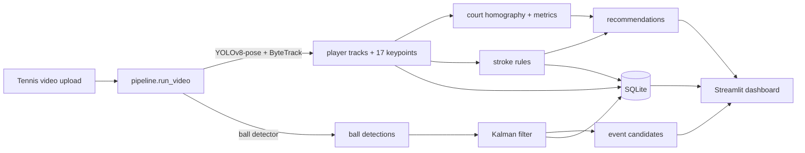

# SmartPlay AI: tennis performance analysis

AI-powered analysis of tennis players from video: player tracking, body pose, court calibration, ball tracking and rule-based stroke analysis, in a Streamlit dashboard.

> **Status:** a working prototype demonstrated on one short tennis clip. Stroke labels are unvalidated rules and no accuracy figure is claimed (no labelled ground truth was available). See [Limitations](#limitations).

## Background

SmartPlay AI started as a critical study of an existing **padel** analytics project (a master's thesis at ISET Bizerte). Six limitations were identified: inconsistent speed calculation, no reliable ball tracking, no stroke or posture analysis, fragile face recognition with weak privacy safeguards, limited evaluation, and unvalidated heuristics. The original club dataset was confidential and could not be shared, so, with the supervisor's approval, the application was rebuilt and **adapted to tennis**.

Course project for **Industrie 4.0** (RAIA 2, ISET Bizerte) by **Eya Ben Houcine**.

## Features

- **Player tracking and pose:** YOLOv8-pose and ByteTrack give each player a stable ID and 17 body keypoints.
- **Court calibration:** a four-point homography on official tennis dimensions (23.77 m × 10.97 m doubles, 8.23 m singles) converts pixels to metres. Time comes from real frame timestamps. Implausible speeds (above 12 m/s) are excluded and counted, not silently accepted. Without calibration the app shows pixels only.
- **Ball tracking:** a constant-velocity Kalman filter separates observed from predicted points and resets after prolonged loss. Bounce and racket/net events are reported only as uncertain candidates.
- **Stroke and posture analysis:** a rule-based baseline labels *Overhead (serve/smash)*, *Forehand*, *Backhand*, *Volley* or *Uncertain*, with elbow, knee and trunk measurements and short coaching observations.
- **Privacy:** anonymous tracking by default. The optional face-identification module needs explicit consent, can return *Unknown*, supports manual correction and full deletion.
- **Analytics and recommendations:** distance, speed and zone statistics; transparent recommendations from a clearly labelled **synthetic** demo catalogue.
- **Engineering:** modular Python package, SQLite storage, CPU-compatible (GPU optional), 21 automated tests.

## Screenshots

| Upload and preview | First frame and run result |
|---|---|
|  |  |
| **Players and court** | **Ball trajectory** |
|  |  |
| **Pose and strokes** | **Pose and strokes** |
|  |  |

*The ball plot shown was captured before a fix: it now breaks the line at every track reset.*

## Architecture



## Installation

Requires Python 3.10 or newer (developed on Python 3.14).

```bash
py -m pip install -r requirements.txt     # Windows; on Linux/macOS use python3 -m pip
```

The YOLO weights (`yolov8n-pose.pt`, `yolov8n.pt`) download automatically on the first run, so an internet connection is needed once.

## Usage

```bash
py -m streamlit run app.py
```

Then open `http://localhost:8501`:

1. In the **Run** tab, upload an MP4, AVI, MOV or MKV tennis clip. Use a short clip first (10 to 30 seconds) in which players are reasonably large.
2. *(Optional, for metres and speeds)* read the pixel coordinates of the four outer court corners from the first-frame preview and enter them in the sidebar in this order: near-left, near-right, far-right, far-left (example: `120,640 1160,640 900,220 380,220`). Choose doubles or singles lines.
3. Click **Run analysis** and wait for the progress bar.
4. Explore the tabs: *Players and court*, *Ball*, *Pose and strokes*, *Insights*, *Identity* (optional) and *Sessions*.

You can upload another video at any time without restarting.

### Main settings

| Setting | Meaning |
|---|---|
| Detection confidence | Minimum confidence for players (default 0.25) |
| Process 1 frame out of | Frame stride: higher is faster, coarser |
| Max processed frames | Upper bound on the run time |
| Detection image size | 640 to 1920 px: larger finds smaller players but is slower |
| Dominant hand | Used by the pose and stroke analysis |
| Court corners / court lines | Enable metres and speeds |

## Project structure

```
app.py                 Streamlit dashboard (upload, settings, tabs, theme)
core/
  pipeline.py          Video loop: YOLOv8-pose, ByteTrack, ball detector, stroke windows
  court.py             Tennis court geometry, homography, zones, player metrics
  ball.py              Kalman ball tracker (observed vs predicted)
  events.py            Bounce and racket/net event candidates
  pose_utils.py        Keypoint features, rule-based strokes, coaching tips
  reco.py, cf.py       TF-IDF recommendations, collaborative filtering
  neumf.py, tracknet.py  NeuMF and TrackNet-style models (untrained, unused by the app)
  identity.py, context.py  Optional identity (consent) and context inputs
  db.py                SQLite schema and storage
  evaluation.py        Precision, recall, F1, ball error (needs labelled data)
scripts/               Dataset preparation, training and evaluation helpers
tests/                 21 automated tests
docs/                  Architecture, datasets, results and defense notes
```

## Testing

```bash
py -m pytest -q
```

21 tests: 19 run without PyTorch and 2 (NeuMF, TrackNet-style model) need PyTorch. They cover the court homography and zones, the speed filter, the Kalman filter, event candidates, the database, stroke rules on **synthetic** skeletons, identity logic, recommendations, evaluation metrics, dataset splitting, a pipeline run with a **fake detector**, and dashboard rendering. They show that the code behaves as designed, **not** that it is accurate on real tennis play.

## Limitations

- Stroke labels are hypotheses: forehand and backhand need a front or rear view (side views return *Uncertain*), serve and smash share one label, and lobs are not attempted.
- Small or distant players may be missed or tracked intermittently at a 640 px inference size.
- Court calibration is manual; zone definitions are heuristic.
- Face identification is optional and has no live detection.

## Roadmap

Label tennis clips and evaluate detection, tracking and strokes; fine-tune a ball detector; train a temporal stroke classifier; separate serve from smash using court position; measure and improve processing time; validate coaching advice with a coach.

## License and data notes

The project uses [Ultralytics YOLO](https://docs.ultralytics.com), licensed under AGPL-3.0 (please verify the current terms before reuse). Videos, model weights and database files are intentionally **not** included in this repository. Add a `LICENSE` file that is compatible with your use. The recommendation catalogue is synthetic demo data.
