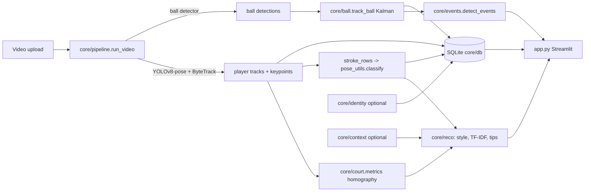

# Architecture

| Module | Input -> output |
|---|---|
| `core/pipeline.py` | video path -> dict of DataFrames (`tracks`, `ball`, `strokes`) + preview frames |
| `core/court.py` | 4 pixel corners -> homography `H`; tracks -> metres, distance, speed, zones |
| `core/ball.py` | per-frame ball (x,y) or None -> trajectory rows with `observed` flag |
| `core/events.py` | trajectory -> bounce / rebound / direction-change CANDIDATES with confidence |
| `core/pose_utils.py` | (T,17,2) keypoints -> angles, speeds, stroke label + reasons |
| `core/reco.py` | style text -> TF-IDF recommendations; rule-based tips; partner heuristic |
| `core/identity.py` | face embedding -> enrolled name or unknown (consent, delete, vote) |
| `core/context.py` | fatigue, duration, optional weather -> general notes |
| `core/db.py` | schema + save/list sessions (video files stay on disk) |
| `core/evaluation.py`, `scripts/` | labelled data -> metrics; dataset split/validation; fine-tuning wrapper |
Coordinate conventions: image space has y pointing down; `pose_utils` flips to y-up; court space is metres, x in 0-10, y in 0-20, net at y=10.
